# Architecture

The homelab has three roles: `yggdrasil` is the edge and infrastructure node,
`midgard` is the primary application node, and `alfheim` is the cloud ARM
application node. External traffic enters through Cloudflare Tunnel → Caddy,
with no directly exposed application ports. The Tailscale tailnet carries
traffic between hosts.

```mermaid
flowchart TD
    internet["Internet users"]
    cloudflare["Cloudflare<br/>DNS / Tunnel edge"]

    subgraph yggdrasil["yggdrasil: edge / infra node"]
        cloudflared["cloudflared<br/>Cloudflare Tunnel client"]
        caddy["Caddy<br/>HTTPS ingress / reverse proxy"]
        blog["Dev with Min blog<br/>Caddy file_server"]
        docsSite["Docs site<br/>Caddy file_server"]
        kuma["Uptime Kuma<br/>127.0.0.1:3001"]
        beszelHub["Beszel hub<br/>:8090"]
        vlogs["VictoriaLogs<br/>:9428"]
        plzUnavailable["jamye-plz disabled<br/>HTTP 503"]
        yShipper["beszel-agent / vlagent"]
    end

    subgraph tailnet["Tailscale tailnet"]
        midgardDns["midgard.tail6fc192.ts.net"]
        alfheimDns["alfheim.tail6fc192.ts.net"]

        subgraph midgard["midgard: application host"]
            homepage["Homepage dashboard<br/>:8082"]
            forgejo["Forgejo<br/>:3000"]
            vaultwarden["Vaultwarden<br/>:8222"]
            mShipper["beszel-agent / vlagent"]
        end

        subgraph alfheim["alfheim: OCI ARM application host"]
            jamyeServer["jamye-server<br/>:8080"]
            serverMedia["jamye-server MinIO<br/>:9000"]
            aShipper["beszel-agent / vlagent"]
        end
    end

    internet --> cloudflare
    cloudflare --> cloudflared
    cloudflared -->|"public ridewithmin.com hostnames<br/>https://localhost:443"| caddy

    caddy -->|"status.ridewithmin.com"| kuma
    caddy -->|"home.ridewithmin.com"| homepage
    caddy -->|"blog.ridewithmin.com"| blog
    caddy -->|"git.ridewithmin.com"| forgejo
    caddy -->|"vault.ridewithmin.com"| vaultwarden
    caddy -->|"jamye-plz / minio.ridewithmin.com"| plzUnavailable
    caddy -->|"jamye-api.ridewithmin.com"| jamyeServer
    caddy -->|"jamye-media.ridewithmin.com"| serverMedia
    caddy -->|"beszel.ridewithmin.com<br/>tailnet only"| beszelHub
    caddy -->|"logs.ridewithmin.com<br/>tailnet only"| vlogs
    caddy -->|"docs.ridewithmin.com"| docsSite

    caddy -.->|backend access over Tailscale| midgardDns
    caddy -.->|backend access over Tailscale| alfheimDns
    midgardDns -.-> homepage
    midgardDns -.-> forgejo
    midgardDns -.-> vaultwarden
    alfheimDns -.-> jamyeServer
    alfheimDns -.-> serverMedia

    yShipper --> beszelHub
    yShipper --> vlogs
    mShipper -.->|metrics WebSocket + journald logs<br/>over Tailscale| beszelHub
    mShipper -.-> vlogs
    aShipper -.->|metrics WebSocket + journald logs<br/>over Tailscale| beszelHub
    aShipper -.-> vlogs
```



The [security model](security.md) explains who can cross each boundary: public
Internet, tailnet, and localhost.

## Shared system configuration

`flake.nix` uses flake-parts and import-tree to load the Den modules. Each host
in `modules/hosts/` selects `den.aspects.homelab-base` and its service aspects.
The shared aspect includes the following system configuration; declaring the
`poby` user also selects its account and home aspect.

Files under `_` directories are ordinary modules, excluded from automatic
discovery and imported explicitly. Defining an aspect does not enable it.
The root nixpkgs input tracks `nixos-unstable`; `flake.lock` pins its revision.

This unstable revision uses systemd in the initrd on all hosts. Existing
`system.stateVersion` values and disk layouts stay unchanged. Tooling outputs
support `x86_64-linux`, `aarch64-linux`, and `aarch64-darwin`; upstream nixpkgs
has dropped `x86_64-darwin` support.

| Module | Purpose |
| --- | --- |
| `modules/aspects/base.nix` | flakes/`nix-command`, systemd-boot, NetworkManager, firewall |
| `modules/aspects/gc.nix` | weekly Nix GC + automatic store optimisation |
| `modules/aspects/swap.nix` | zram swap (no separate swap partition) |
| `modules/aspects/poby.nix` | operator `poby` (`wheel`, passwordless sudo) |
| `modules/aspects/ssh.nix` | OpenSSH, password/root login disabled |
| `modules/aspects/tailscale.nix` | Tailscale |
| `modules/aspects/secrets.nix` | sops-nix base configuration |
| `modules/aspects/log-shipper.nix` | journald → VictoriaLogs shipping on every host (journal-upload + vlagent) |
| `modules/aspects/beszel-agent.nix` | Beszel metrics agent on every host |

## Storage

`disko` declares the disk layout. All hosts use a simple single-disk GPT
layout.

```text
GPT partition table
512M EFI System Partition  -> /boot, vfat
remaining disk             -> /, ext4
```

## User environment

Each host declares `users.poby.classes = ["homeManager"]`, so Den integrates
Home Manager into NixOS and applies it during each host switch. It configures
only the operator environment. `modules/aspects/poby.nix` contains the account,
shell, Git, tmux, and operator tools such as `age`, `sops`, and `just`.
Host aspects use `provides.poby.homeManager` for local aliases. Midgard also
includes the Hermes aspect through `provides.poby.includes`.
