# 아키텍처

구성은 엣지/인프라 노드(`yggdrasil`), 주 애플리케이션 노드(`midgard`),
클라우드 ARM 애플리케이션 노드(`alfheim`)로 나뉩니다. 외부 트래픽은 포트를
직접 열지 않고 Cloudflare Tunnel → Caddy 경로로만 들어오며 호스트 간 내부
통신은 Tailscale tailnet 안에서 이루어집니다.

```mermaid
flowchart TD
    internet["인터넷 사용자"]
    cloudflare["Cloudflare<br/>DNS / Tunnel 엣지"]

    subgraph yggdrasil["yggdrasil: 엣지 / 인프라 노드"]
        cloudflared["cloudflared<br/>Cloudflare Tunnel 클라이언트"]
        caddy["Caddy<br/>HTTPS 인그레스 / 리버스 프록시"]
        blog["Dev with Min 블로그<br/>Caddy file_server"]
        docsSite["문서 사이트<br/>Caddy file_server"]
        kuma["Uptime Kuma<br/>127.0.0.1:3001"]
        beszelHub["Beszel 허브<br/>:8090"]
        vlogs["VictoriaLogs<br/>:9428"]
        plzUnavailable["jamye-plz 비활성<br/>HTTP 503"]
        yShipper["beszel-agent / vlagent"]
    end

    subgraph tailnet["Tailscale tailnet"]
        midgardDns["midgard.tail6fc192.ts.net"]
        alfheimDns["alfheim.tail6fc192.ts.net"]

        subgraph midgard["midgard: 애플리케이션 호스트"]
            homepage["Homepage 대시보드<br/>:8082"]
            forgejo["Forgejo<br/>:3000"]
            vaultwarden["Vaultwarden<br/>:8222"]
            mShipper["beszel-agent / vlagent"]
        end

        subgraph alfheim["alfheim: OCI ARM 애플리케이션 호스트"]
            jamyeServer["jamye-server<br/>:8080"]
            serverMedia["jamye-server MinIO<br/>:9000"]
            aShipper["beszel-agent / vlagent"]
        end
    end

    internet --> cloudflare
    cloudflare --> cloudflared
    cloudflared -->|"공개 ridewithmin.com 호스트명<br/>https://localhost:443"| caddy

    caddy -->|"status.ridewithmin.com"| kuma
    caddy -->|"home.ridewithmin.com"| homepage
    caddy -->|"blog.ridewithmin.com"| blog
    caddy -->|"git.ridewithmin.com"| forgejo
    caddy -->|"vault.ridewithmin.com"| vaultwarden
    caddy -->|"jamye-plz / minio.ridewithmin.com"| plzUnavailable
    caddy -->|"jamye-api.ridewithmin.com"| jamyeServer
    caddy -->|"jamye-media.ridewithmin.com"| serverMedia
    caddy -->|"beszel.ridewithmin.com<br/>tailnet 전용"| beszelHub
    caddy -->|"logs.ridewithmin.com<br/>tailnet 전용"| vlogs
    caddy -->|"docs.ridewithmin.com"| docsSite

    caddy -.->|Tailscale 경유 백엔드 접근| midgardDns
    caddy -.->|Tailscale 경유 백엔드 접근| alfheimDns
    midgardDns -.-> homepage
    midgardDns -.-> forgejo
    midgardDns -.-> vaultwarden
    alfheimDns -.-> jamyeServer
    alfheimDns -.-> serverMedia

    yShipper --> beszelHub
    yShipper --> vlogs
    mShipper -.->|"메트릭 WebSocket + journald 로그<br/>Tailscale 경유"| beszelHub
    mShipper -.-> vlogs
    aShipper -.->|"메트릭 WebSocket + journald 로그<br/>Tailscale 경유"| beszelHub
    aShipper -.-> vlogs
```



공개 인터넷, tailnet, localhost 경계별 접근 주체는
[보안 모델](security.md)에서 다룹니다.

## 공유 시스템 구성

`flake.nix`는 flake-parts와 import-tree로 Den 모듈을 로드합니다.
`modules/hosts/`의 각 호스트는 `den.aspects.homelab-base`와 필요한 서비스
aspect를 선택합니다. 공통 aspect는 아래 시스템 설정을 포함하고, `poby`
사용자 선언은 해당 계정과 home aspect를 선택합니다.

`_` 디렉토리의 일반 모듈은 자동 탐색에서 제외하고 명시적으로 import합니다.
aspect 정의만으로 서비스가 활성화되지는 않습니다. 루트 nixpkgs 입력은
`nixos-unstable`을 추적하며 revision은 `flake.lock`에 고정합니다.

이 unstable revision은 모든 호스트의 initrd에서 systemd를 사용합니다.
기존 `system.stateVersion` 값과 디스크 레이아웃은 유지합니다. 도구용 출력은
`x86_64-linux`, `aarch64-linux`, `aarch64-darwin`을 지원합니다. upstream
nixpkgs에서 지원을 종료한 `x86_64-darwin`은 제외합니다.

| 모듈 | 내용 |
| --- | --- |
| `modules/aspects/base.nix` | flakes/`nix-command`, systemd-boot, NetworkManager, 방화벽 |
| `modules/aspects/gc.nix` | 주간 Nix GC + 스토어 자동 최적화 |
| `modules/aspects/swap.nix` | zram 스왑 (별도 스왑 파티션 없음) |
| `modules/aspects/poby.nix` | 운영자 `poby` (`wheel`, passwordless sudo) |
| `modules/aspects/ssh.nix` | OpenSSH, 패스워드/루트 로그인 비활성 |
| `modules/aspects/tailscale.nix` | Tailscale |
| `modules/aspects/secrets.nix` | sops-nix 기본 설정 |
| `modules/aspects/log-shipper.nix` | 모든 호스트의 journald → VictoriaLogs 전송 (journal-upload + vlagent) |
| `modules/aspects/beszel-agent.nix` | 모든 호스트의 Beszel 메트릭 에이전트 |

## 스토리지

디스크 레이아웃은 `disko`로 선언하며 모든 호스트가 단일 디스크 GPT
레이아웃을 사용합니다.

```text
GPT 파티션 테이블
512M EFI 시스템 파티션  -> /boot, vfat
나머지 디스크           -> /, ext4
```

## 사용자 환경

각 호스트가 `users.poby.classes = ["homeManager"]`를 선언하면 Den이
Home Manager를 NixOS에 통합하고 호스트 switch 시 함께 적용합니다.
운영자 환경만 관리하며 `modules/aspects/poby.nix`에 계정, 셸/Git/tmux 설정,
`age`·`sops`·`just` 같은 운영 도구를 둡니다. 호스트 aspect는
`provides.poby.homeManager`로 별칭을 추가합니다. Midgard는
`provides.poby.includes`로 Hermes aspect도 포함합니다.
